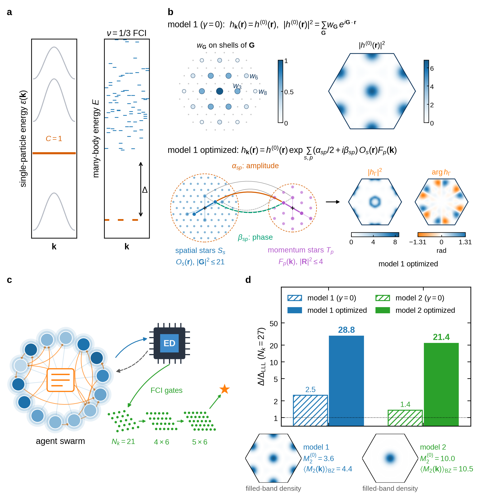
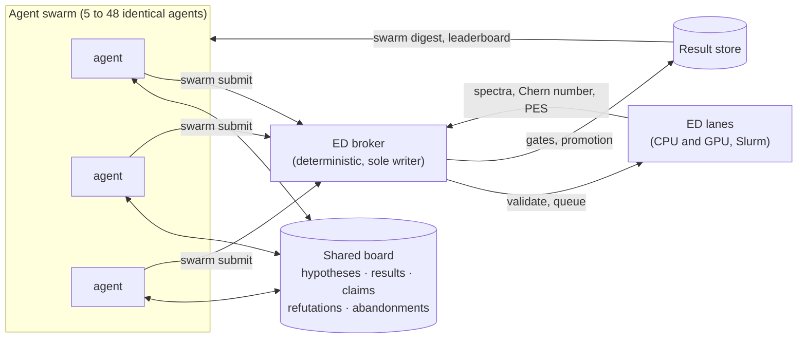

<div align="center">

# MOSAIC

**M**ulti-agent **O**pen-ended **S**cientific **A**nalysis and **I**nvestigation through **C**ollaboration

[](LICENSE)
[](pyproject.toml)
[](julia/Project.toml)
[](https://github.com/Zou-Bo/MomentumED.jl)

</div>

## News

- 2026-10-20 -- MOSAIC released.

<p align="center">
  
</p>

---

## Contents

- [Highlights](#highlights)
- [How MOSAIC works](#how-mosaic-works)
- [Repository layout](#repository-layout)
- [Installation](#installation)
- [Quick start](#quick-start)
- [The ED solver](#the-ed-solver)
- [Running a campaign](#running-a-campaign)
- [Reproducing the paper](#reproducing-the-paper)
- [Data](#data)
- [Citation](#citation)
- [Acknowledgments](#acknowledgments)
- [License](#license)

## Highlights

- **Open-ended search without a planner.** The agents are identical, autonomous Claude Code agents (Claude Opus 5.5)
  sharing one message board. None is assigned a role, a region of the search space or a method. Who explores what,
  and whose results to build on, is up to the agents.
- **A referee that cannot be argued with.** A deterministic broker is the only process that runs ED and records
  results. Every number on the board must quote a broker result, and a candidate counts only if it passes phase
  gates on several finite-size clusters.
- **The result.** The agents searched topological flat bands whose Bloch states are lowest-Landau-level orbitals
  times a momentum-dependent envelope. They found ν = 1/3 Laughlin states with gaps more than ten times those of the
  corresponding bands with ideal quantum geometry:

  | 27-site cluster, N = 9 | gap at γ = 0 (ideal geometry) | gap of the optimized band |
  |---|---|---|
  | Model 1 | 2.50 Δ_LLL | **28.75 Δ_LLL** |
  | Model 2 | 1.36 Δ_LLL | **21.37 Δ_LLL** |

- **A measured swarm effect.** Every campaign also ran isolated agents with the same brief, quota and tools, but
  without the board.
  - On the clusters used during the search, the strongest swarms raised the gaps by factors of R_min = 10.8
    (model 1) and 16.3 (model 2).
  - The isolated agents on model 1 reached 1.1–3.2.
  - On model 2, three of the six isolated agents found no band that passed every test; the others reached 3.6, 7.5
    and 11.5.
- **A faster solver.** The solver keeps the sector Hamiltonians on the GPU and solves them with an on-device Lanczos
  method. One evaluation takes 6.4 s on a 4×6 cluster and 41 s on a 5×6 cluster on one H100. The original
  single-threaded CPU code took 593 s and 3.8 h.

## How MOSAIC works



- **Agents.** Each agent is a Claude Code session in `/loop` mode with its own git worktree and notebook.
  - Every agent receives the same charter and campaign brief (`swarm/charter.md`, `swarm/missions/`).
  - An agent writes its own analysis scripts and optimizers, but acts on shared state only through the `swarm`
    command: `digest`, `submit`, `post`, `mail`, `leaderboard`, …
  - Agents run in a bubblewrap sandbox that hides other campaigns and the analysis folders.
- **Board.** Posts are immutable, time-stamped and typed:
  - a *hypothesis*, which must be posted before an agent spends more than ten evaluations on a direction;
  - a *result*, a *claim*, a *refutation* or a *note*;
  - an *abandonment*, which records what a dropped direction taught;
  - a *request* to the humans.

  Requests can declare the request they build on, which makes the provenance of every finding traceable.
- **Broker.** The broker:
  - rejects requests outside the search boundary;
  - runs the accepted ones on persistent solver lanes;
  - applies the phase gates (below);
  - promotes each candidate up the evaluation ladder;
  - labels claims.

  It is the only writer of the result store.
- **Controls.** Each campaign also runs isolated agents with the same prompts, apart from the passages on
  coordination, and no access to the board, mail or other agents' requests.

**Evaluation ladder.** A band climbs one stage at a time. It is promoted when it has passed every gate so far and
its smallest gain R = Δ/Δ⁽⁰⁾ so far reaches the next stage's threshold.

| Stage | Cluster (electrons) | Accuracy | Gates | Entry threshold |
|---|---|---|---|---|
| Screen | 21-site symmetric (7) | search | split, PES (N_A = 2) | – |
| Confirm | 21-site symmetric (7) | confirm | split, PES (N_A = 3) | R ≥ 1.02 |
| 4×6 | 4×6 (8) | confirm | split, PES, C | R ≥ 1 |
| 5×6 | 5×6 (10) | confirm | split, PES, C | R ≥ 1 |
| Converge | 4×6 (8), larger cutoffs | confirm | split, PES, C | R ≥ 1.05 on 4×6 and 5×6 |

The gates:
- **split:** the three lowest states are split by less than 10% of the gap;
- **PES:** the particle entanglement spectrum shows the (1,3)-admissible counting with an entanglement gap of at
  least 0.5;
- **C:** the many-body Chern number equals that of the γ = 0 band.

A strong claim requires R ≥ 1.1 on 4×6, 5×6 and the converged rerun. The thresholds and the search boundary are in
the `clusters`, `stages`, `claims` and `gates` blocks of each config in `configs/`.

## Repository layout

```
MOSAIC/
├── src/mosaic/
│   ├── swarm/        broker, agent CLI, config schema, phase gates, validation, Slurm pool, launch setup
│   ├── ed/           ED input/output contract (JSON, schema v1), mock ED for tests
│   ├── store/        result store (SQLite index over files on disk)
│   ├── physics/      envelope deformations, lattice and form-factor helpers
│   └── util/         hashing and logging
├── swarm/            what the agents read: charter, campaign briefs, parent bands, templates; bin/swarm
├── configs/          the eight campaigns of the paper
├── jobs/, scripts/   Slurm templates, agent launcher, login-node session, solver setup
├── julia/            the ED solver: CLI, sources, tests, benchmarks, MomentumED.jl patch
├── data/             bands, spectra, source data and agent records (see data/README.md)
└── tests/            Python tests, including a mock end-to-end swarm run
```

## Installation

**Requirements**
- Linux.
- Python ≥ 3.11 with [uv](https://docs.astral.sh/uv/).
- Julia ≥ 1.10 (tested with 1.10.2).
- Optional: an NVIDIA GPU with CUDA for the GPU solver (tested on H100 and A100).
- To run swarm campaigns: Slurm, [Claude Code](https://claude.com/claude-code) and
  [bubblewrap](https://github.com/containers/bubblewrap).

```bash
git clone https://github.com/ChangwenXu98/MOSAIC.git
cd MOSAIC

uv sync                                  # Python environment
scripts/setup_solver.sh                  # Julia environment; set JULIA=/path/to/julia if julia is not on PATH
```

`scripts/setup_solver.sh` does three things:
- clones [MomentumED.jl](https://github.com/Zou-Bo/MomentumED.jl) into `julia/deps/` at commit `40400d4`;
- applies a small patch (`julia/patches/`);
- instantiates `julia/` from the shipped `Manifest.toml`, which pins every package at the version used for the paper.

To check the installation:

```bash
uv run pytest                                      # 141 tests, about a minute, mock ED
julia --project=julia julia/test/runtests.jl       # solver tests; the GPU test runs only where CUDA is functional
```

## Quick start

**Evaluate a band.** This test input is a 4×6 cluster with a momentum-dependent envelope, and takes about 90 s on
8 CPU threads:

```bash
julia --project=julia -t 8 julia/ed_solver.jl \
    --config julia/test/data/nk24_p024_a1M_kdep.json --out out.json
uv run python -c "import json; o = json.load(open('out.json')); print(o['status'], o['gap_top_indirect_solver'], o['chern_solver'])"
```

**Re-evaluate a band from the paper** on the 27-site cluster, and compare with the stored result. A GPU is
recommended:

```bash
MOIRE_ED_BACKEND=gpu julia --project=julia julia/ed_solver.jl \
    --config data/bands/model1_optimized_5eda.json --out 5eda.json
# compare with data/spectra/sym27/5eda/ed_output.json
```

**Watch a swarm without a cluster.** The mock end-to-end test runs a broker, agents and the full promotion
ladder against a synthetic ED:

```bash
uv run pytest tests/swarm -q
```

## The ED solver

The solver projects a gate-screened Coulomb interaction onto a single Chern band and diagonalizes it in every
total-momentum sector of a finite cluster.
- **The band** is a superposition of Landau levels with coefficients `a_n`, times a periodic envelope with density
  Fourier coefficients `W_G`. An optional deformation block (α_sp, β_sp) makes the envelope momentum-dependent.
- **The output** reports:
  - the many-body gap;
  - the low-lying spectrum of every sector;
  - the many-body Chern number, from a glued twisted-boundary lattice;
  - optionally, the particle entanglement spectrum.

**Interface.** JSON in, JSON out. The schema is the pydantic models `EDInput` and `EDOutput` in
`src/mosaic/ed/contract.py`. Two entry points:

```bash
# one evaluation per process
julia --project=julia julia/ed_solver.jl --config ed_input.json --out ed_output.json

# a persistent lane: evaluates every <root>/<glob>/ed_input.json without an ed_output.json,
# claiming each run directory atomically, so compilation is paid once per lane
julia --project=julia julia/ed_batch.jl <root> '<glob>'
```

**Options.**

| Setting | Values |
|---|---|
| `extra.ed_accuracy` | `search`: Krylov tolerance 1e-6, m+1 levels per sector. `confirm` (default): 1e-12, 6 levels. The two agree to \|Δgap\| ≤ 7e-15 with the same Chern number. |
| `extra.nk1`, `extra.nk2` / `extra.symcluster` | rectangular clusters / symmetric 21- and 27-site clusters |
| `extra.pes` | particle entanglement spectrum (`NA`, cut and counting options) |
| `MOIRE_ED_BACKEND` | `cpu`, `gpu` or `auto` (default). `auto` uses a GPU when `CUDA_VISIBLE_DEVICES` is set and the largest sector has ≥ 20k states. |

The GPU path keeps each sector matrix on the device when it fits, and falls back to a matrix-free map otherwise.
Several GPUs share a batch of sector solves.

**Performance** (one evaluation, many-body gap and Chern number; source data `data/source_data/fig3_speedup.json`):

| Cluster | Original code, 1 CPU thread | This solver, 16 CPU threads | This solver, 1 H100 |
|---|---|---|---|
| 4×6 | 593 s | 28 s | **6.4 s** |
| 5×6 | 3.8 h | 23 min | **41 s** |

## Running a campaign

1. **Set the site values in the campaign config.** The released configs carry placeholders:
   - Slurm partitions (`cpu`, `gpu-h100`, `gpu-a100`);
   - the `julia` and `claude` binaries;
   - `agent_deny_read`, the paths emptied in each agent's sandbox.
2. **Build the entanglement-count table** for the PES gate, and point `gates.pes_expected_counts` at it. The
   table for the paper's clusters ships as `swarm/templates/pes_expected_counts.json`, and the released configs
   use it.
   ```bash
   uv run python -m mosaic.swarm pes-cases --config configs/swarm_kgll_w3_n18.yaml > cases.json
   julia --project=julia scripts/pes_expected_counts.jl . cases.json counts.json
   ```
3. **Prepare the campaign.** This creates one worktree per agent and renders each agent's charter. It also
   snapshots the solver at `broker.solver_ref`, together with `julia/deps/`, so every evaluation of the campaign
   runs the same frozen code.
   ```bash
   uv run python -m mosaic.swarm setup --config configs/swarm_kgll_w3_n18.yaml
   ```
4. **Start the broker and the supervisor** in a tmux session on a login node. The supervisor submits the agent
   allocations and resubmits them at each walltime, and agents resume their sessions.
   ```bash
   scripts/swarm_login.sh configs/swarm_kgll_w3_n18.yaml
   ```

To point MOSAIC at a new question, write a new brief in `swarm/missions/` and a config with your parents, clusters,
gates and search boundary. The charter and briefs are released as the agents saw them (they match Supplementary
Section S-VI of the paper), so they mention project notes that are not part of this repository.

## Reproducing the paper

| Campaign | Model | Swarm agents | Isolated agents | Config |
|---|---|---|---|---|
| `kgll-w3-n5`, `kgll-w3-n18`, `kgll-w3-n48` | 1 | 5, 18, 48 | 2 each | `configs/swarm_kgll_w3_n{5,18,48}.yaml` |
| `kgll-p3-n5`, `kgll-p3-n18`, `kgll-p3-n48` | 2 | 5, 18, 48 | 2 each | `configs/swarm_kgll_p3_n{5,18,48}.yaml` |
| `kgll-ll0-1` (before the search boundary) | 1 | 18 | 2 | `configs/swarm_kgll_ll0.yaml` |
| `kgll-p3-n20` (before the search boundary) | 2 | 20 | 2 | `configs/swarm_kgll_p3_n20.yaml` |

- Every agent had a quota of 500 evaluations and a 48 h deadline. Campaigns ran on Claude Opus 5.5.
- The solver version of all campaigns was `moire-julia-ed@v0.9.1`, which is the solver in this repository.
- LLM agents are not deterministic, so a rerun gives a different search. What can be reproduced exactly is every
  number the search produced: each band in `data/` is a complete solver input.

## Data

Everything is plain JSON or Markdown. See [`data/README.md`](data/README.md) for the file-by-file guide.

| Folder | Content |
|---|---|
| `data/bands/` | the γ = 0 bands, the optimized bands and other candidates, as complete solver inputs |
| `data/spectra/` | 27-site spectra of each band, and the screening-length scans |
| `data/source_data/` | the values plotted in each figure and table |
| `data/agent_records/` | for each campaign: every request with its results, board posts, direct messages, agent notebooks, token usage |

People's names in the agent records are replaced by `[author]`. The Claude Code transcripts are not released.

## Citation

If you use MOSAIC, the solver or the data, please cite the paper:

```bibtex
@article{zhang2026mosaic,
  title   = {Agentic Swarms Discover Enhancement of Fractional Chern Insulator Gaps Beyond Ideal Quantum Geometry},
  author  = {Zhang, Yitong and Xu, Changwen and Li, Andrew Boshi and Sarkar, Siddhartha and Sun, Kai and
             Viswanathan, Venkatasubramanian},
  year    = {2026}
}
```

## Acknowledgments

**MomentumED.jl.** The ED solver is built on [**MomentumED.jl**](https://github.com/Zou-Bo/MomentumED.jl) by
Zou Bo. We use its many-body basis and Hilbert-space machinery (`EDCore`), its momentum decomposition and
Hamiltonian construction, and its Krylov and CUDA eigensolver infrastructure (`MomentumED`). The Coulomb vertex and
reciprocal-lattice conventions follow its Landau-level torus example. We thank Zou Bo for making the package openly
available under the MIT license. The small patch we apply is described in
[`julia/patches/README.md`](julia/patches/README.md); see also [`NOTICE`](NOTICE).

## License

MOSAIC is released under the [MIT License](LICENSE). MomentumED.jl, which the setup script downloads, is
distributed under its own MIT license; see [`NOTICE`](NOTICE).
