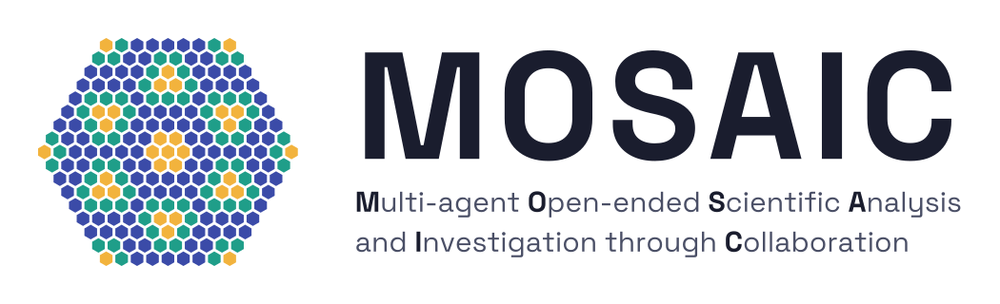
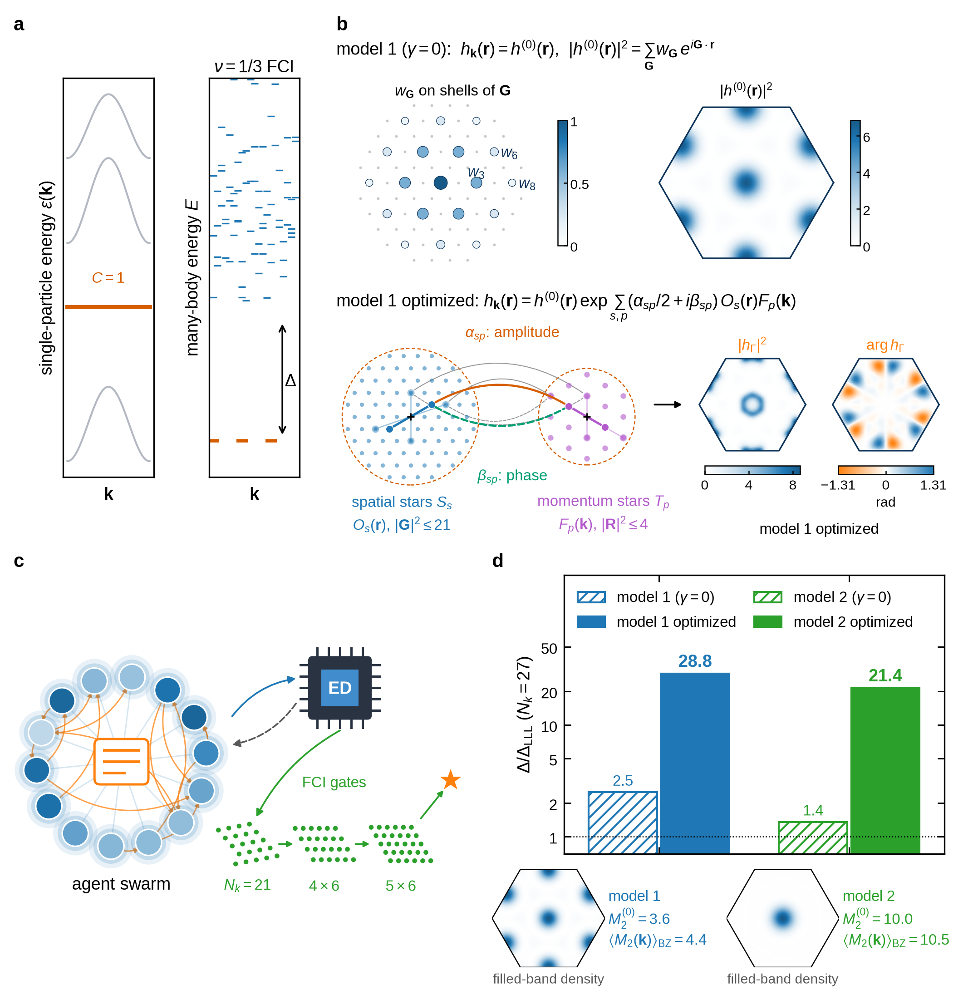
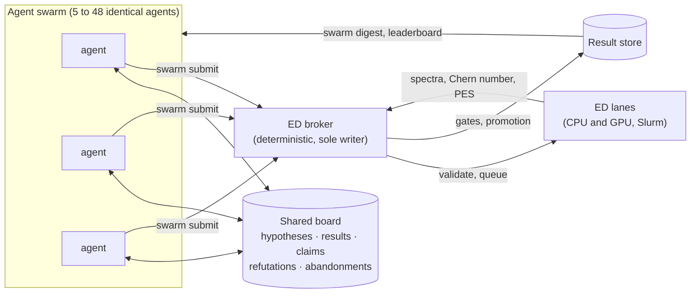

<div align="center">

<picture>
  <source media="(prefers-color-scheme: dark)" srcset="assets/logo/mosaic-lockup-tagline-dark.svg">
  <source media="(prefers-color-scheme: light)" srcset="assets/logo/mosaic-lockup-tagline-light.svg">
  
</picture>

[](https://arxiv.org/abs/2610.35934)
[](https://scifm.github.io/MOSAIC/)
[](LICENSE)
[](pyproject.toml)
[](julia/Project.toml)

</div>

## News

- 2026-10-20 -- Our paper [Agentic Swarms Discover Enhanchment of Fractional Chern Insulator Gaps Beyond Ideal Quantum Geometry](https://arxiv.org/abs/2610.35934) and agent swarm implementation <strong><em>MOSAIC</em></strong> are released.

<p align="center">
  
</p>

---

## Contents

- [Highlights](#highlights)
- [How MOSAIC works](#how-mosaic-works)
- [Repository layout](#repository-layout)
- [Installation](#installation)
- [Quick start](#quick-start)
- [The ED solver](#the-ed-solver)
- [Running the agent swarm](#running-the-agent-swarm)
  - [Prerequisites](#prerequisites)
  - [1. Configure a campaign](#1-configure-a-campaign)
  - [2. Prepare the campaign](#2-prepare-the-campaign)
  - [3. Launch](#3-launch)
  - [4. Monitor and steer](#4-monitor-and-steer)
  - [5. Stop, resume and collect](#5-stop-resume-and-collect)
  - [The `swarm` command](#the-swarm-command)
  - [A new research question](#a-new-research-question)
- [Reproducing the paper](#reproducing-the-paper)
- [Data](#data)
- [Citation](#citation)
- [Acknowledgments](#acknowledgments)
- [License](#license)

## Highlights

- **Open-ended search without a planner.** The agents are identical, autonomous coding agents sharing one message
  board. None is assigned a role, a region of the search space or a method. Who explores what,
  and whose results to build on, is up to the agents.
- **A referee that cannot be argued with.** A deterministic broker is the only process that runs ED and records
  results. Every number on the board must quote a broker result, and a candidate counts only if it passes phase
  gates on several finite-size clusters.
- **The result.** The agents searched topological flat bands whose Bloch states are lowest-Landau-level orbitals
  times a momentum-dependent envelope. They found ν = 1/3 Laughlin states with gaps more than ten times those of the
  corresponding bands with ideal quantum geometry:

  | 27-site cluster, N = 9 | gap at γ = 0 (ideal geometry) | gap of the optimized band |
  |---|---|---|
  | Model 1 | 2.50 Δ_LLL | **28.75 Δ_LLL** |
  | Model 2 | 1.36 Δ_LLL | **21.37 Δ_LLL** |

- **A faster solver.** The solver keeps the sector Hamiltonians on the GPU and solves them with an on-device Lanczos
  method. One evaluation takes 6.4 s on a 4×6 cluster and 41 s on a 5×6 cluster on one H100. The original
  single-threaded CPU code took 593 s and 3.8 h.

## How MOSAIC works



- **Agents.** Each agent is a long-running coding-agent session with its own git worktree and notebook.
  - Every agent receives the same charter and campaign brief (`swarm/charter.md`, `swarm/missions/`).
  - An agent writes its own analysis scripts and optimizers, but acts on shared state only through the `swarm`
    command: `digest`, `submit`, `post`, `mail`, `leaderboard`, …
  - Agents run in a bubblewrap sandbox that hides other campaigns and the analysis folders.
- **Board.** Posts are immutable, time-stamped and typed:
  - a *hypothesis*, which must be posted before an agent spends more than ten evaluations on a direction;
  - a *result*, a *claim*, a *refutation* or a *note*;
  - an *abandonment*, which records what a dropped direction taught;
  - a *request* to the humans.

  Requests can declare the request they build on, which makes the provenance of every finding traceable.
- **Broker.** The broker:
  - rejects requests outside the search boundary;
  - runs the accepted ones on persistent solver lanes;
  - applies the phase gates (below);
  - promotes each candidate up the evaluation ladder;
  - labels claims.

  It is the only writer of the result store.
- **Controls.** Each campaign also runs isolated agents with the same prompts, apart from the passages on
  coordination, and no access to the board, mail or other agents' requests.

**Evaluation ladder.** A band climbs one stage at a time. It is promoted when it has passed every gate so far and
its smallest gain R = Δ/Δ⁽⁰⁾ so far reaches the next stage's threshold.

| Stage | Cluster (electrons) | Accuracy | Gates | Entry threshold |
|---|---|---|---|---|
| Screen | 21-site symmetric (7) | search | split, PES (N_A = 2) | – |
| Confirm | 21-site symmetric (7) | confirm | split, PES (N_A = 3) | R ≥ 1.02 |
| 4×6 | 4×6 (8) | confirm | split, PES, C | R ≥ 1 |
| 5×6 | 5×6 (10) | confirm | split, PES, C | R ≥ 1 |
| Converge | 4×6 (8), larger cutoffs | confirm | split, PES, C | R ≥ 1.05 on 4×6 and 5×6 |

The gates:
- **split:** the three lowest states are split by less than 10% of the gap;
- **PES:** the particle entanglement spectrum shows the (1,3)-admissible counting with an entanglement gap of at
  least 0.5;
- **C:** the many-body Chern number equals that of the γ = 0 band.

A strong claim requires R ≥ 1.1 on 4×6, 5×6 and the converged rerun. The thresholds and the search boundary are in
the `clusters`, `stages`, `claims` and `gates` blocks of each config in `configs/`.

## Repository layout

```
MOSAIC/
├── src/mosaic/
│   ├── swarm/        broker, agent CLI, config schema, phase gates, validation, Slurm pool, launch setup
│   ├── ed/           ED input/output contract (JSON, schema v1), mock ED for tests
│   ├── store/        result store (SQLite index over files on disk)
│   ├── physics/      envelope deformations, lattice and form-factor helpers
│   └── util/         hashing and logging
├── swarm/            what the agents read: charter, campaign briefs, parent bands, templates; bin/swarm
├── configs/          the eight campaigns of the paper
├── jobs/, scripts/   Slurm templates, agent launcher, login-node session, solver setup
├── julia/            the ED solver: CLI, sources, tests, benchmarks, MomentumED.jl patch
├── data/             bands, spectra, source data and agent records (see data/README.md)
├── docs/             the project page (GitHub Pages, served from this folder)
└── tests/            Python tests, including a mock end-to-end swarm run
```

## Installation

**Requirements**
- Linux.
- Python ≥ 3.11 with [uv](https://docs.astral.sh/uv/).
- Julia ≥ 1.10 (tested with 1.10.2).
- Optional: an NVIDIA GPU with CUDA for the GPU solver (tested on H100 and A100).
- To run swarm campaigns: Slurm, tmux, [Claude Code](https://docs.claude.com/en/docs/claude-code) and
  [bubblewrap](https://github.com/containers/bubblewrap); see [Running the agent swarm](#running-the-agent-swarm).

```bash
git clone https://github.com/ChangwenXu98/MOSAIC.git
cd MOSAIC

uv sync                                  # Python environment
scripts/setup_solver.sh                  # Julia environment; set JULIA=/path/to/julia if julia is not on PATH
```

`scripts/setup_solver.sh` does three things:
- clones [MomentumED.jl](https://github.com/Zou-Bo/MomentumED.jl) into `julia/deps/` at commit `40400d4`;
- applies a small patch (`julia/patches/`);
- instantiates `julia/` from the shipped `Manifest.toml`, which pins every package at the version used for the paper.

To check the installation:

```bash
uv run pytest                                      # 141 tests, about a minute, mock ED
julia --project=julia julia/test/runtests.jl       # solver tests; the GPU test runs only where CUDA is functional
```

## Quick start

**Evaluate a band.** This test input is a 4×6 cluster with a momentum-dependent envelope, and takes about 90 s on
8 CPU threads:

```bash
julia --project=julia -t 8 julia/ed_solver.jl \
    --config julia/test/data/nk24_p024_a1M_kdep.json --out out.json
uv run python -c "import json; o = json.load(open('out.json')); print(o['status'], o['gap_top_indirect_solver'], o['chern_solver'])"
```

**Re-evaluate a band from the paper** on the 27-site cluster, and compare with the stored result. A GPU is
recommended:

```bash
MOIRE_ED_BACKEND=gpu julia --project=julia julia/ed_solver.jl \
    --config data/bands/model1_optimized_5eda.json --out 5eda.json
# compare with data/spectra/sym27/5eda/ed_output.json
```

**Watch a swarm without a cluster.** The mock end-to-end test runs a broker, agents and the full promotion
ladder against a synthetic ED:

```bash
uv run pytest tests/swarm -q
```

## The ED solver

The solver projects a gate-screened Coulomb interaction onto a single Chern band and diagonalizes it in every
total-momentum sector of a finite cluster.
- **The band** is a superposition of Landau levels with coefficients `a_n`, times a periodic envelope with density
  Fourier coefficients `W_G`. An optional deformation block (α_sp, β_sp) makes the envelope momentum-dependent.
- **The output** reports:
  - the many-body gap;
  - the low-lying spectrum of every sector;
  - the many-body Chern number, from a glued twisted-boundary lattice;
  - optionally, the particle entanglement spectrum.

**Interface.** JSON in, JSON out. The schema is the pydantic models `EDInput` and `EDOutput` in
`src/mosaic/ed/contract.py`. Two entry points:

```bash
# one evaluation per process
julia --project=julia julia/ed_solver.jl --config ed_input.json --out ed_output.json

# a persistent lane: evaluates every <root>/<glob>/ed_input.json without an ed_output.json,
# claiming each run directory atomically, so compilation is paid once per lane
julia --project=julia julia/ed_batch.jl <root> '<glob>'
```

**Options.**

| Setting | Values |
|---|---|
| `extra.ed_accuracy` | `search`: Krylov tolerance 1e-6, m+1 levels per sector. `confirm` (default): 1e-12, 6 levels. The two agree to \|Δgap\| ≤ 7e-15 with the same Chern number. |
| `extra.nk1`, `extra.nk2` / `extra.symcluster` | rectangular clusters / symmetric 21- and 27-site clusters |
| `extra.pes` | particle entanglement spectrum (`NA`, cut and counting options) |
| `MOIRE_ED_BACKEND` | `cpu`, `gpu` or `auto` (default). `auto` uses a GPU when `CUDA_VISIBLE_DEVICES` is set and the largest sector has ≥ 20k states. |

The GPU path keeps each sector matrix on the device when it fits, and falls back to a matrix-free map otherwise.
Several GPUs share a batch of sector solves.

**Performance** (one evaluation, many-body gap and Chern number; source data `data/source_data/fig3_speedup.json`):

| Cluster | Original code, 1 CPU thread | This solver, 16 CPU threads | This solver, 1 H100 |
|---|---|---|---|
| 4×6 | 593 s | 28 s | **6.4 s** |
| 5×6 | 3.8 h | 23 min | **41 s** |

## Running the agent swarm

A campaign is one YAML file in `configs/`. It defines one or more **arms** of agents, the **parent** bands the
agents try to beat, the **clusters** and **stages** of the evaluation ladder, the **gates**, the **search
boundary**, the **quotas**, and the Slurm resources of the **broker** and the **agents**. All commands below use
`configs/swarm_kgll_w3_n18.yaml` as the example; replace it with your config.

Three kinds of process run during a campaign:

| Process | Where | Started by | Role |
|---|---|---|---|
| broker | login node, tmux window `broker` | `scripts/swarm_login.sh` | validates requests, submits ED pool jobs, applies gates, promotes, writes results and leaderboards |
| supervisor | login node, tmux window `supervise` | `scripts/swarm_login.sh` | submits each arm's agent allocation, and resubmits it at walltime while agents remain |
| agents | one Slurm allocation per arm, one tmux window per agent | the supervisor | long-running Claude Code sessions that act through the `swarm` command |

ED evaluations run in **pool jobs** that the broker keeps alive per tier (`broker.tiers`): at most `max_jobs`
allocations per tier, each with `lanes` workers pulling from a queue, so the swarm stays at a handful of Slurm
jobs whatever the number of agents.

### Prerequisites

In addition to the [installation](#installation) above (`uv sync` and `scripts/setup_solver.sh`, which the solver
snapshot requires):

- **Slurm** with `sbatch`, `sacct` and `scontrol` on the node where the broker runs, and **tmux** on the login node
  and on the compute nodes.
- **[Claude Code](https://docs.claude.com/en/docs/claude-code)** installed on the compute nodes, and logged in
  (`claude`, then `/login`) under the account that runs the campaign. The agents use the subscription login by
  default: `agent_job.unset_api_key: true` unsets any inherited `ANTHROPIC_API_KEY`. Set it to `false` to bill an
  API key instead.
- **[bubblewrap](https://github.com/containers/bubblewrap)** (`bwrap`) on the compute nodes. An agent is never
  launched without its sandbox; if `bwrap` fails, the launcher retries every 5 minutes and logs the failure.
- Check the tests pass: `uv run pytest tests/swarm -q` runs a broker, agents and the full ladder against a mock ED.

### 1. Configure a campaign

Copy one of the released configs and edit it. The released configs carry site placeholders that you must set:

| Key | What to set |
|---|---|
| `broker.tiers.<tier>.partition` (and `reservation`, `qos`) | your CPU and GPU partitions (placeholders: `cpu`, `gpu-h100`, `gpu-a100`) |
| `broker.tiers.<tier>.lanes`, `threads`, `gpus`, `mem`, `walltime`, `max_jobs` | the size of each ED pool job; for a GPU tier, `gpus` must be a multiple of `lanes` |
| `broker.julia` | path to the `julia` binary on the compute nodes |
| `agent_job.partition` (and `reservation`, `qos`, `walltime`) | where the agent sessions run; they need CPU and memory only (`cpus_per_agent`, `mem_per_agent_gb`) |
| `agent_job.claude`, `agent_job.model` | path to the `claude` binary, and an optional model name (`null` uses the default) |
| `agent_deny_read` | paths emptied in each agent's sandbox, e.g. other campaigns, analysis folders, other Claude transcript folders |

The other keys you are likely to change:

- `swarm_id`: a short name; it also names the git branches (`swarm/<swarm_id>/<agent>`) and tmux sessions.
- `root`: where the campaign's state lives (default `runs_swarm/<swarm_id>`, relative to the repository).
- `worktree_root`: where the agent worktrees are created (default `../mosaic-wt/<swarm_id>`, outside the repository).
- `arms`: one entry per arm. `mode: shared` gives the arm a common board, mail, roster and leaderboard;
  `mode: private` isolates every agent (the controls). Agent names must be unique across arms.
- `quotas`: evaluations charged per agent (first stage only; promotions are free) and requests in flight.
- `deadline_utc`: after this time the broker refuses new requests (`null` for none).
- `agent_job.stagger_seconds`: delay between agent launches within an arm, so later agents read earlier plans.
- `agent_deny_bash`: extra Bash command prefixes the agents may not run (the released configs deny `git`).

The **PES gate** needs a table of the expected Laughlin (1,3) counts for every cluster with `pes_na` set. The table
for the paper's clusters ships as `swarm/templates/pes_expected_counts.json`, and the released configs use it. For
new clusters, build one and point `gates.pes_expected_counts` at it:

```bash
uv run python -m mosaic.swarm pes-cases --config configs/swarm_kgll_w3_n18.yaml > cases.json
julia --project=julia scripts/pes_expected_counts.jl . cases.json counts.json
```

The **parents' expected gaps** (`parents.<name>.expected_gap`) are the gaps measured before the campaign on each
cluster. The broker evaluates every parent first, and halts if its own values disagree beyond `expected_rtol`,
which catches a changed solver or parent before any agent result is trusted. Remove the entries for a parent or
cluster you have not measured yet.

### 2. Prepare the campaign

```bash
uv run python -m mosaic.swarm setup --config configs/swarm_kgll_w3_n18.yaml
```

`setup` launches nothing and is safe to rerun. It creates:

- the arm directories under `root` (layout below) and each parent's solver input in `<root>/<arm>/parents/`;
- a **solver snapshot** at `<worktree_root>/solver-<solver_ref>`: a git worktree of `broker.solver_ref` together
  with a copy of `julia/deps/` and the pinned `Manifest.toml`, so every evaluation of the campaign runs the same
  frozen code even if the main checkout changes;
- for each agent, a **git worktree** on branch `swarm/<swarm_id>/<agent>` containing:
  - `CHARTER.md`, the rendered charter (`swarm/charter.md` with the campaign brief from `mission` inserted);
  - `NOTEBOOK.md`, the agent's memory across restarts;
  - `work/`, where the agent writes its own scripts;
  - `.claude/settings.local.json`, permission guardrails: no edits to `src/`, `julia/`, `configs/`, `docs/`, `jobs/`,
    `scripts/`, `swarm/` or the campaign root, no reads of other arms (or, in a private arm, of other agents), and no
    `sbatch`, `srun`, `salloc`, `scancel`, `git commit` or `git push`;
- a fixed Claude Code session id per agent (`<root>/<arm>/agents/<agent>/session.json`), so an agent resumes the
  same conversation after every restart;
- the agent allocation script of each arm, `<root>/<arm>/agents_job.sbatch`.

`--no-worktrees` and `--no-solver` skip those two steps, which is useful to validate a config.

Before launching, it is worth running the broker for one tick, which builds the parents and checks the config
end to end, and asking the supervisor what it would submit:

```bash
uv run python -m mosaic.swarm broker --config configs/swarm_kgll_w3_n18.yaml --once
uv run python -m mosaic.swarm supervise --config configs/swarm_kgll_w3_n18.yaml --dry-run
```

### 3. Launch

On a login node, from the repository root:

```bash
scripts/swarm_login.sh configs/swarm_kgll_w3_n18.yaml
```

This starts the tmux session `swarm-<swarm_id>` with two windows:

- `broker`: the broker, ticking every `broker.tick_seconds`. It submits the parents' evaluations first, then
  accepts agent requests. If it exits for any reason other than a halt, it restarts after 60 s; its state is all
  on disk.
- `supervise`: every 120 s, submits each arm's agent allocation if none is pending or running and some agent has
  not finished. The allocation is sized to the agents still running.

Each agent allocation (`jobs/swarm_agents.sbatch`) starts a tmux server on its compute node with one window per
agent. Each window runs `scripts/swarm_agent.sh`, which:

1. puts the `swarm` command on `PATH` and moves into the agent's worktree;
2. builds the bubblewrap sandbox, in which the `agent_deny_read` paths appear empty;
3. starts Claude Code with the charter appended to its system prompt and a `/loop` prompt: each wakeup the agent
   runs `swarm digest`, decides, acts, writes to `NOTEBOOK.md`, runs `swarm heartbeat` and paces its next wakeup;
4. on any exit before the agent has written `done`, resumes the same session after 30 s.

The allocation ends when every agent of the arm has run `swarm done`, or at walltime, after which the supervisor
resubmits it and the agents resume.

### 4. Monitor and steer

**Watch the agents.** Attach to an arm's agent sessions (the job id is in `<root>/<arm>/agents_jobs.json` or
`squeue`):

```bash
srun --jobid=<job_id> --overlap --pty tmux -L swarm-<swarm_id>-<arm> attach -t <arm>
```

Switch windows with tmux's `Ctrl-b n` / `Ctrl-b p`, or `Ctrl-b w` to pick an agent; detach with `Ctrl-b d`.
Detaching does not stop anything.

**Watch the broker:** `tmux attach -t swarm-<swarm_id>` on the login node.

**Read the campaign state.** Everything is plain files under `<root>/<arm>/`:

```
<root>/<arm>/
├── leaderboard.md, leaderboard.json   ranked requests per parent, other phases, controls, budget
├── board/                             every post (private arm: board/<agent>/)
├── mail/<agent>/                      directed mail (shared arm only)
├── agents/<agent>/                    status.json (roster), session.json, launches.log, leaderboard (private arm), done
├── inbox/<agent>/<req_id>/            request.json, ed_input.json; accepted.json and result.json from the broker
├── store/                             index.db and runs/<hash>/ (solver input and output of every evaluation)
├── pool/<tier>/, jobs/<tier>/         queued evaluations, pool job scripts and logs
├── parents/, parents.json             parent inputs and their measured gaps
└── agents_<job_id>.log                agent allocation log
```

To see what an agent sees, run the agent commands with its identity:

```bash
export SWARM_CONFIG=$(realpath configs/swarm_kgll_w3_n18.yaml) SWARM_AGENT=swarm-a PATH=$PWD/swarm/bin:$PATH
swarm leaderboard
swarm digest --no-mark      # --no-mark: do not mark the agent's posts and mail as read
swarm status
```

**Answer the agents.** Agents escalate physics questions with `request` posts addressed to the human. Answer on
the board (shared arm), or on one agent's own board in a private arm (`--to` required there):

```bash
uv run python -m mosaic.swarm human --config configs/swarm_kgll_w3_n18.yaml --arm swarm \
    --title "Re: matched-density control" --to swarm-c --ref <post_id> < answer.md
```

With `--to` in a shared arm, the post also goes to that agent's mail.

### 5. Stop, resume and collect

- **Halts.** The broker writes `<root>/HALT` with a reason and stops when something invalidates the campaign: a
  parent gap that disagrees with `expected_gap`, a parent failing its own gates, or an output from a solver other
  than `broker.solver_version_prefix`. Agents see the halt at the top of their digest and stop submitting; the
  supervisor stops resubmitting allocations. Fix the cause, delete `<root>/HALT`, and run
  `scripts/swarm_login.sh` again (kill the old tmux session first: `tmux kill-session -t swarm-<swarm_id>`).
- **Stopping by hand.** Create `<root>/HALT` with a reason. The supervisor will not resubmit agent allocations and
  agents stop submitting; stop the running pieces with `tmux kill-session -t swarm-<swarm_id>` and `scancel` on
  the agent and pool jobs.
- **Restarting.** Every step is keyed on content hashes and recorded on disk, so the broker, the supervisor and
  the agents can be killed and restarted at any time without losing or rerunning evaluations. A pool job that
  died while holding a run is detected and the run is requeued.
- **Ending.** An agent ends by running `swarm done` with a final summary; it is not relaunched afterwards. The
  supervisor exits when every agent of every arm is done. The broker keeps running to finish queued promotions;
  stop it with `tmux kill-session` once the leaderboard no longer changes.
- **Collecting.** The results are in `<root>/<arm>/` (store, board, mail, leaderboards) and each agent's notebook
  and scripts in its worktree. `data/agent_records/` in this repository has the same records for the paper's
  campaigns.

### The `swarm` command

Agents act on shared state only through `swarm` (`swarm/bin/swarm`, which runs `python -m mosaic.swarm` from the
main checkout). Agent commands read `SWARM_CONFIG` and `SWARM_AGENT` from the environment, which the launcher sets.

| Command | Purpose |
|---|---|
| `swarm digest` | what changed since the last look: halts, parents, budget, roster, new posts, unread mail, own requests, leaderboard |
| `swarm reference` | parents and their gaps, pinning, gates, the stage ladder, claim thresholds |
| `swarm template --parent P [--out F]` | a parent's solver input to start from |
| `swarm check INPUT.json --parent P` | validate exactly as the broker will (pinning, admissibility, search boundary) |
| `swarm submit INPUT.json --family F --parent P [--note N] [--builds-on REQ_ID]` | queue a request on the first stage; promotion is automatic |
| `swarm submit ... --diagnostic` | a probe: first stage only, never promoted or ranked |
| `swarm submit ... --control [--clusters r46,r56]` | a mechanism control: static density not pinned, never ranked |
| `swarm submit-batch DIR --family F --parent P` | submit every `*.json` in a directory (for optimizer loops) |
| `swarm withdraw REQ_ID ...` | stop promoting own requests; their queued runs go to the back |
| `swarm status [REQ_ID]`, `swarm show REQ_ID` | own requests and results; any visible request's input and result |
| `swarm post --kind K --family F --title T [--ref ID] < body.md` | an immutable board post; kinds: `hypothesis`, `result`, `claim`, `refutation`, `abandon`, `request`, `note` |
| `swarm mail --to AGENT --subject S < body.md`, `swarm read ID` | a directed message (shared arm only); the full text of a post or mail |
| `swarm heartbeat --family F [--state active\|waiting] [--note N]` | update the agent's roster entry |
| `swarm leaderboard` | the leaderboard visible to the agent |
| `swarm done < summary.md` | post a final summary and stop |

Operator commands take `--config`: `setup`, `broker [--once]`, `supervise [--once] [--dry-run]`, `human`,
`pes-cases`. Run `uv run python -m mosaic.swarm <command> --help` for every option.

### A new research question

MOSAIC's broker, ladder and tools are generic over parents, clusters and gates; the physics the agents see comes
from two files:

- the **charter**, `swarm/charter.md`: the rules, scoring and tools, shared by every campaign (placeholders such as
  `{agent}`, `{quota}` and `{mission}` are filled in by `setup`);
- the **campaign brief**, a Markdown file in `swarm/missions/` named by the config's `mission` key: the question,
  the fixed setup, the parents and what counts as a result.

To point MOSAIC at a new question, write a new brief and a config with your parents (`ed_input` files or shell
weights), clusters, stages, claims, gates and search boundary. `directions` can optionally give individual agents
a starting direction; by default agents choose their own scope on the board. The charter and briefs are released
as the agents saw them (they match Supplementary Section S-VI of the paper), so they mention project notes that
are not part of this repository; edit those references for a new campaign.

## Reproducing the paper

| Campaign | Model | Swarm agents | Isolated agents | Config |
|---|---|---|---|---|
| `kgll-w3-n5`, `kgll-w3-n18`, `kgll-w3-n48` | 1 | 5, 18, 48 | 2 each | `configs/swarm_kgll_w3_n{5,18,48}.yaml` |
| `kgll-p3-n5`, `kgll-p3-n18`, `kgll-p3-n48` | 2 | 5, 18, 48 | 2 each | `configs/swarm_kgll_p3_n{5,18,48}.yaml` |
| `kgll-ll0-1` (before the search boundary) | 1 | 18 | 2 | `configs/swarm_kgll_ll0.yaml` |
| `kgll-p3-n20` (before the search boundary) | 2 | 20 | 2 | `configs/swarm_kgll_p3_n20.yaml` |

- Every agent had a quota of 500 evaluations and a 48 h deadline. The agents in the paper's campaigns ran on Claude
  Opus 5.5.
- The solver version of all campaigns was `moire-julia-ed@v0.9.1`, which is the solver in this repository.
- LLM agents are not deterministic, so a rerun gives a different search. What can be reproduced exactly is every
  number the search produced: each band in `data/` is a complete solver input.

## Data

Everything is plain JSON or Markdown. See [`data/README.md`](data/README.md) for the file-by-file guide.

| Folder | Content |
|---|---|
| `data/bands/` | the γ = 0 bands, the optimized bands and other candidates, as complete solver inputs |
| `data/spectra/` | 27-site spectra of each band, and the screening-length scans |
| `data/source_data/` | the values plotted in each figure and table |
| `data/agent_records/` | for each campaign: every request with its results, board posts, direct messages, agent notebooks, token usage |

People's names in the agent records are replaced by `[author]`. The agents' session transcripts are not released.

## Citation

If you use MOSAIC, the solver or the data, please cite the paper:

```bibtex
@article{zhang2026agentic,
  title={Agentic Swarms Discover Enhanchment of Fractional Chern Insulator Gaps Beyond Ideal Quantum Geometry},
  author={Zhang, Yitong and Xu, Changwen and Li, Andrew Boshi and Sarkar, Siddhartha and Sun, Kai and Viswanathan, Venkatasubramanian},
  journal={arXiv preprint arXiv:2610.35934},
  year={2026}
}
```

## Acknowledgments

**MomentumED.jl.** The ED solver is built on [**MomentumED.jl**](https://github.com/Zou-Bo/MomentumED.jl) by
Zou Bo. We use its many-body basis and Hilbert-space machinery (`EDCore`), its momentum decomposition and
Hamiltonian construction, and its Krylov and CUDA eigensolver infrastructure (`MomentumED`). The Coulomb vertex and
reciprocal-lattice conventions follow its Landau-level torus example. We thank Zou Bo for making the package openly
available under the MIT license. The small patch we apply is described in
[`julia/patches/README.md`](julia/patches/README.md); see also [`NOTICE`](NOTICE).

## License

MOSAIC is released under the [MIT License](LICENSE). MomentumED.jl, which the setup script downloads, is
distributed under its own MIT license; see [`NOTICE`](NOTICE).
