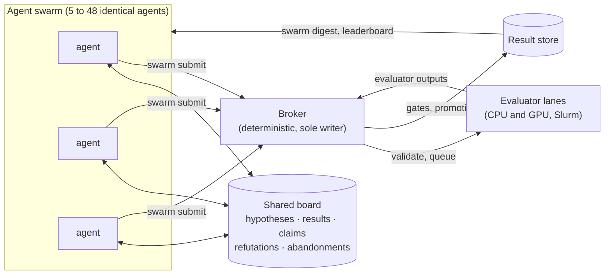

<div align="center">

<picture>
  <source media="(prefers-color-scheme: dark)" srcset="assets/logo/mosaic-lockup-tagline-dark.svg">
  <source media="(prefers-color-scheme: light)" srcset="assets/logo/mosaic-lockup-tagline-light.svg">
  
</picture>

[](https://arxiv.org/abs/2610.35934)
[](https://scifm.github.io/MOSAIC/)
[](LICENSE)
[](pyproject.toml)
[](julia/Project.toml)

</div>

## News

- 2026-10-20 -- Our paper [Agentic Swarms Discover Enhanchment of Fractional Chern Insulator Gaps Beyond Ideal Quantum Geometry](https://arxiv.org/abs/2610.35934) and agent swarm implementation <strong><em>MOSAIC</em></strong> are released.

<p align="center">
  
</p>

---

## Contents

- [Highlights](#highlights)
- [How MOSAIC works](#how-mosaic-works)
- [Installation](#installation)
- [Quick start](#quick-start)
- [Running the agent swarm](#running-the-agent-swarm)
  - [Prerequisites](#prerequisites)
  - [1. Configure a campaign](#1-configure-a-campaign)
  - [2. Prepare the campaign](#2-prepare-the-campaign)
  - [3. Launch](#3-launch)
  - [4. Monitor and steer](#4-monitor-and-steer)
  - [5. Stop, resume and collect](#5-stop-resume-and-collect)
  - [The `swarm` command](#the-swarm-command)
- [Adapting MOSAIC to your own problem](#adapting-mosaic-to-your-own-problem)
  - [Concepts and their counterparts](#concepts-and-their-counterparts)
  - [Level 1: a new question for an existing evaluator](#level-1-a-new-question-for-an-existing-evaluator)
  - [Level 2: a new evaluator](#level-2-a-new-evaluator)
  - [Test before you spend compute](#test-before-you-spend-compute)
  - [Without Slurm](#without-slurm)
- [Repository layout](#repository-layout)
- [Application in the paper: fractional Chern insulator gaps](#application-in-the-paper-fractional-chern-insulator-gaps)
  - [The evaluation ladder in the paper](#the-evaluation-ladder-in-the-paper)
  - [The ED solver](#the-ed-solver)
  - [Reproducing the paper](#reproducing-the-paper)
  - [Data](#data)
- [Citation](#citation)
- [Acknowledgments](#acknowledgments)
- [License](#license)

## Highlights

MOSAIC runs a swarm of autonomous coding agents on an open-ended search: many candidates, an expensive evaluator,
and validity checks that decide whether a result counts.

- **Open-ended search without a planner.** The agents are identical, autonomous coding agents sharing one message
  board. None is assigned a role, a region of the search space or a method. Who explores what, and whose results
  to build on, is up to the agents.
- **A referee that cannot be argued with.** A deterministic broker is the only process that runs the evaluator and
  records results. Every number on the board must quote a broker result, and a candidate counts only if it passes
  the validity gates at every fidelity level it reaches.
- **A multi-fidelity ladder.** Candidates are screened cheaply and promoted to more expensive evaluations by a
  threshold on their own results, never by rank, so no agent can learn about another through promotion.
- **Built-in controls.** Each campaign can run isolated agents with the same prompts and tools but no board, which
  measures what collaboration adds.
- **Built for long campaigns on a shared cluster.** Evaluations run in a handful of Slurm pool jobs however many
  agents there are. All state is on disk, so every process can be killed and restarted, and agents resume their
  own sessions after each allocation ends. Agents run in a sandbox with permission guardrails.
- **Demonstrated on a physics problem.** In the paper, the swarm searched topological flat bands and found
  ν = 1/3 fractional Chern insulators with many-body gaps more than ten times those of bands with ideal quantum
  geometry. See [the application](#application-in-the-paper-fractional-chern-insulator-gaps).

## How MOSAIC works



- **Agents.** Each agent is a long-running Claude Code session with its own git worktree and notebook.
  - Every agent receives the same charter and campaign brief (`swarm/charter.md`, `swarm/missions/`).
  - An agent writes its own analysis scripts and optimizers, but acts on shared state only through the `swarm`
    command: `digest`, `submit`, `post`, `mail`, `leaderboard`, …
  - Agents run in a bubblewrap sandbox that hides other campaigns and any folders you list.
- **Board.** Posts are immutable, time-stamped and typed:
  - a *hypothesis*, which must be posted before an agent spends more than ten evaluations on a direction;
  - a *result*, a *claim*, a *refutation* or a *note*;
  - an *abandonment*, which records what a dropped direction taught;
  - a *request* to the humans.

  Requests can declare the request they build on, which makes the provenance of every finding traceable.
- **Broker.** The broker:
  - validates each request against its baseline (the *parent*) and rejects requests outside the search boundary;
  - queues accepted requests on the first stage of the ladder and runs them on persistent evaluator lanes;
  - applies the gates to every output and scores it as R = objective / parent's objective at the same fidelity;
  - promotes a candidate to the next stage when every gate so far has passed and its smallest R so far reaches
    the stage's threshold;
  - labels claims and writes the leaderboards.

  It is the only writer of the result store.
- **Controls.** Each campaign can also run isolated agents with the same prompts, apart from the passages on
  coordination, and no access to the board, mail or other agents' requests.

The stages, gates, thresholds, claims and search boundary are all set in the campaign config; the paper's ladder
is shown [below](#the-evaluation-ladder-in-the-paper).

## Installation

**Requirements**
- Linux.
- Python ≥ 3.11 with [uv](https://docs.astral.sh/uv/).
- To run campaigns: Slurm, tmux, [Claude Code](https://docs.claude.com/en/docs/claude-code) and
  [bubblewrap](https://github.com/containers/bubblewrap); see [Prerequisites](#prerequisites).
- For the paper's evaluator only: Julia ≥ 1.10 (tested with 1.10.2), and optionally an NVIDIA GPU with CUDA
  (tested on H100 and A100).

```bash
git clone https://github.com/ChangwenXu98/MOSAIC.git
cd MOSAIC
uv sync                                  # the swarm (Python)
scripts/setup_solver.sh                  # the paper's ED solver (Julia); set JULIA=/path/to/julia if needed
uv run pytest                            # 141 tests, about a minute, mock evaluator
```

`scripts/setup_solver.sh` is needed only for the paper's evaluator; see [The ED solver](#the-ed-solver).

## Quick start

**1. Watch a swarm without a cluster.** The mock end-to-end tests run a broker, agents and the full promotion
ladder against a synthetic evaluator, including broker crashes, dead jobs and quota limits:

```bash
uv run pytest tests/swarm -q
```

**2. Look at a campaign as an agent sees it.** Prepare the directories of one of the paper's campaigns, without
worktrees or a solver snapshot, and use the agent commands with an agent's identity:

```bash
uv run python -m mosaic.swarm setup --config configs/swarm_kgll_w3_n18.yaml --no-worktrees --no-solver

export SWARM_CONFIG=$(realpath configs/swarm_kgll_w3_n18.yaml) SWARM_AGENT=swarm-a PATH=$PWD/swarm/bin:$PATH
swarm reference                          # parents, gates, the stage ladder, claim thresholds
swarm template --parent w3 --out cand.json
swarm check cand.json --parent w3        # validated exactly as the broker will
swarm digest                             # what the agent reads at every wakeup
```

This writes the campaign's state to `runs_swarm/kgll-w3-n18/`; delete it afterwards.

**3. Run a campaign** on a Slurm cluster: [Running the agent swarm](#running-the-agent-swarm).

**4. Point MOSAIC at your own problem:** [Adapting MOSAIC to your own problem](#adapting-mosaic-to-your-own-problem).

## Running the agent swarm

A campaign is one YAML file. It defines one or more **arms** of agents, the **parents** (baselines) the agents
try to beat, the **clusters** (fidelity levels) and **stages** of the evaluation ladder, the **gates**, the
**search boundary**, the **quotas**, and the Slurm resources of the **broker** and the **agents**. The commands
below use the paper's `configs/swarm_kgll_w3_n18.yaml` as the example; replace it with your config. To write a
config and brief for your own question, or to plug in your own evaluator, see
[Adapting MOSAIC to your own problem](#adapting-mosaic-to-your-own-problem).

Three kinds of process run during a campaign:

| Process | Where | Started by | Role |
|---|---|---|---|
| broker | login node, tmux window `broker` | `scripts/swarm_login.sh` | validates requests, submits evaluator pool jobs, applies gates, promotes, writes results and leaderboards |
| supervisor | login node, tmux window `supervise` | `scripts/swarm_login.sh` | submits each arm's agent allocation, and resubmits it at walltime while agents remain |
| agents | one Slurm allocation per arm, one tmux window per agent | the supervisor | long-running Claude Code sessions that act through the `swarm` command |

Evaluations run in **pool jobs** that the broker keeps alive per tier (`broker.tiers`): at most `max_jobs`
allocations per tier, each with `lanes` workers pulling from a queue, so the swarm stays at a handful of Slurm
jobs whatever the number of agents.

### Prerequisites

In addition to the [installation](#installation) above (`uv sync`, and for the paper's evaluator
`scripts/setup_solver.sh`):

- **Slurm** with `sbatch`, `sacct` and `scontrol` on the node where the broker runs, and **tmux** on the login node
  and on the compute nodes.
- **[Claude Code](https://docs.claude.com/en/docs/claude-code)** installed on the compute nodes, and logged in
  (`claude`, then `/login`) under the account that runs the campaign. The agents use the subscription login by
  default: `agent_job.unset_api_key: true` unsets any inherited `ANTHROPIC_API_KEY`. Set it to `false` to bill an
  API key instead.
- **[bubblewrap](https://github.com/containers/bubblewrap)** (`bwrap`) on the compute nodes. An agent is never
  launched without its sandbox; if `bwrap` fails, the launcher retries every 5 minutes and logs the failure.
- Check the tests pass: `uv run pytest tests/swarm -q` runs a broker, agents and the full ladder against a mock evaluator.

### 1. Configure a campaign

Copy one of the released configs and edit it. The released configs carry site placeholders that you must set:

| Key | What to set |
|---|---|
| `broker.tiers.<tier>.partition` (and `reservation`, `qos`) | your CPU and GPU partitions (placeholders: `cpu`, `gpu-h100`, `gpu-a100`) |
| `broker.tiers.<tier>.lanes`, `threads`, `gpus`, `mem`, `walltime`, `max_jobs` | the size of each evaluator pool job; for a GPU tier, `gpus` must be a multiple of `lanes` |
| `broker.julia` | path to the `julia` binary on the compute nodes (paper's evaluator) |
| `agent_job.partition` (and `reservation`, `qos`, `walltime`) | where the agent sessions run; they need CPU and memory only (`cpus_per_agent`, `mem_per_agent_gb`) |
| `agent_job.claude`, `agent_job.model` | path to the `claude` binary, and an optional model name (`null` uses the default) |
| `agent_deny_read` | paths emptied in each agent's sandbox, e.g. other campaigns, analysis folders, other Claude transcript folders |

The other keys you are likely to change:

- `swarm_id`: a short name; it also names the git branches (`swarm/<swarm_id>/<agent>`) and tmux sessions.
- `root`: where the campaign's state lives (default `runs_swarm/<swarm_id>`, relative to the repository).
- `worktree_root`: where the agent worktrees are created (default `../mosaic-wt/<swarm_id>`, outside the repository).
- `arms`: one entry per arm. `mode: shared` gives the arm a common board, mail, roster and leaderboard;
  `mode: private` isolates every agent (the controls). Agent names must be unique across arms.
- `quotas`: evaluations charged per agent (first stage only; promotions are free) and requests in flight.
- `deadline_utc`: after this time the broker refuses new requests (`null` for none).
- `agent_job.stagger_seconds`: delay between agent launches within an arm, so later agents read earlier plans.
- `agent_deny_bash`: extra Bash command prefixes the agents may not run (the released configs deny `git`).

The paper's **PES gate** needs a table of the expected Laughlin (1,3) counts for every cluster with `pes_na` set. The table
for the paper's clusters ships as `swarm/templates/pes_expected_counts.json`, and the released configs use it. For
new clusters, build one and point `gates.pes_expected_counts` at it:

```bash
uv run python -m mosaic.swarm pes-cases --config configs/swarm_kgll_w3_n18.yaml > cases.json
julia --project=julia scripts/pes_expected_counts.jl . cases.json counts.json
```

The **parents' expected values** (`parents.<name>.expected_gap`) are the parents' objectives measured before the
campaign on each cluster. The broker evaluates every parent first, and halts if its own values disagree beyond
`expected_rtol`, which catches a changed evaluator or parent before any agent result is trusted. Remove the entries for a parent or
cluster you have not measured yet.

### 2. Prepare the campaign

```bash
uv run python -m mosaic.swarm setup --config configs/swarm_kgll_w3_n18.yaml
```

`setup` launches nothing and is safe to rerun. It creates:

- the arm directories under `root` (layout below) and each parent's solver input in `<root>/<arm>/parents/`;
- a **solver snapshot** at `<worktree_root>/solver-<solver_ref>`: a git worktree of `broker.solver_ref` together
  with a copy of `julia/deps/` and the pinned `Manifest.toml`, so every evaluation of the campaign runs the same
  frozen code even if the main checkout changes;
- for each agent, a **git worktree** on branch `swarm/<swarm_id>/<agent>` containing:
  - `CHARTER.md`, the rendered charter (`swarm/charter.md` with the campaign brief from `mission` inserted);
  - `NOTEBOOK.md`, the agent's memory across restarts;
  - `work/`, where the agent writes its own scripts;
  - `.claude/settings.local.json`, permission guardrails: no edits to `src/`, `julia/`, `configs/`, `docs/`, `jobs/`,
    `scripts/`, `swarm/` or the campaign root, no reads of other arms (or, in a private arm, of other agents), and no
    `sbatch`, `srun`, `salloc`, `scancel`, `git commit` or `git push`;
- a fixed Claude Code session id per agent (`<root>/<arm>/agents/<agent>/session.json`), so an agent resumes the
  same conversation after every restart;
- the agent allocation script of each arm, `<root>/<arm>/agents_job.sbatch`.

`--no-worktrees` and `--no-solver` skip those two steps, which is useful to validate a config.

Before launching, it is worth running the broker for one tick, which builds the parents and checks the config
end to end, and asking the supervisor what it would submit:

```bash
uv run python -m mosaic.swarm broker --config configs/swarm_kgll_w3_n18.yaml --once
uv run python -m mosaic.swarm supervise --config configs/swarm_kgll_w3_n18.yaml --dry-run
```

### 3. Launch

On a login node, from the repository root:

```bash
scripts/swarm_login.sh configs/swarm_kgll_w3_n18.yaml
```

This starts the tmux session `swarm-<swarm_id>` with two windows:

- `broker`: the broker, ticking every `broker.tick_seconds`. It submits the parents' evaluations first, then
  accepts agent requests. If it exits for any reason other than a halt, it restarts after 60 s; its state is all
  on disk.
- `supervise`: every 120 s, submits each arm's agent allocation if none is pending or running and some agent has
  not finished. The allocation is sized to the agents still running.

Each agent allocation (`jobs/swarm_agents.sbatch`) starts a tmux server on its compute node with one window per
agent. Each window runs `scripts/swarm_agent.sh`, which:

1. puts the `swarm` command on `PATH` and moves into the agent's worktree;
2. builds the bubblewrap sandbox, in which the `agent_deny_read` paths appear empty;
3. starts Claude Code with the charter appended to its system prompt and a `/loop` prompt: each wakeup the agent
   runs `swarm digest`, decides, acts, writes to `NOTEBOOK.md`, runs `swarm heartbeat` and paces its next wakeup;
4. on any exit before the agent has written `done`, resumes the same session after 30 s.

The allocation ends when every agent of the arm has run `swarm done`, or at walltime, after which the supervisor
resubmits it and the agents resume.

### 4. Monitor and steer

**Watch the agents.** Attach to an arm's agent sessions (the job id is in `<root>/<arm>/agents_jobs.json` or
`squeue`):

```bash
srun --jobid=<job_id> --overlap --pty tmux -L swarm-<swarm_id>-<arm> attach -t <arm>
```

Switch windows with tmux's `Ctrl-b n` / `Ctrl-b p`, or `Ctrl-b w` to pick an agent; detach with `Ctrl-b d`.
Detaching does not stop anything.

**Watch the broker:** `tmux attach -t swarm-<swarm_id>` on the login node.

**Read the campaign state.** Everything is plain files under `<root>/<arm>/`:

```
<root>/<arm>/
├── leaderboard.md, leaderboard.json   ranked requests per parent, other phases, controls, budget
├── board/                             every post (private arm: board/<agent>/)
├── mail/<agent>/                      directed mail (shared arm only)
├── agents/<agent>/                    status.json (roster), session.json, launches.log, leaderboard (private arm), done
├── inbox/<agent>/<req_id>/            request.json, ed_input.json; accepted.json and result.json from the broker
├── store/                             index.db and runs/<hash>/ (solver input and output of every evaluation)
├── pool/<tier>/, jobs/<tier>/         queued evaluations, pool job scripts and logs
├── parents/, parents.json             parent inputs and their measured gaps
└── agents_<job_id>.log                agent allocation log
```

To see what an agent sees, run the agent commands with its identity:

```bash
export SWARM_CONFIG=$(realpath configs/swarm_kgll_w3_n18.yaml) SWARM_AGENT=swarm-a PATH=$PWD/swarm/bin:$PATH
swarm leaderboard
swarm digest --no-mark      # --no-mark: do not mark the agent's posts and mail as read
swarm status
```

**Answer the agents.** Agents escalate physics questions with `request` posts addressed to the human. Answer on
the board (shared arm), or on one agent's own board in a private arm (`--to` required there):

```bash
uv run python -m mosaic.swarm human --config configs/swarm_kgll_w3_n18.yaml --arm swarm \
    --title "Re: matched-density control" --to swarm-c --ref <post_id> < answer.md
```

With `--to` in a shared arm, the post also goes to that agent's mail.

### 5. Stop, resume and collect

- **Halts.** The broker writes `<root>/HALT` with a reason and stops when something invalidates the campaign: a
  parent gap that disagrees with `expected_gap`, a parent failing its own gates, or an output from a solver other
  than `broker.solver_version_prefix`. Agents see the halt at the top of their digest and stop submitting; the
  supervisor stops resubmitting allocations. Fix the cause, delete `<root>/HALT`, and run
  `scripts/swarm_login.sh` again (kill the old tmux session first: `tmux kill-session -t swarm-<swarm_id>`).
- **Stopping by hand.** Create `<root>/HALT` with a reason. The supervisor will not resubmit agent allocations and
  agents stop submitting; stop the running pieces with `tmux kill-session -t swarm-<swarm_id>` and `scancel` on
  the agent and pool jobs.
- **Restarting.** Every step is keyed on content hashes and recorded on disk, so the broker, the supervisor and
  the agents can be killed and restarted at any time without losing or rerunning evaluations. A pool job that
  died while holding a run is detected and the run is requeued.
- **Ending.** An agent ends by running `swarm done` with a final summary; it is not relaunched afterwards. The
  supervisor exits when every agent of every arm is done. The broker keeps running to finish queued promotions;
  stop it with `tmux kill-session` once the leaderboard no longer changes.
- **Collecting.** The results are in `<root>/<arm>/` (store, board, mail, leaderboards) and each agent's notebook
  and scripts in its worktree. `data/agent_records/` in this repository has the same records for the paper's
  campaigns.

### The `swarm` command

Agents act on shared state only through `swarm` (`swarm/bin/swarm`, which runs `python -m mosaic.swarm` from the
main checkout). Agent commands read `SWARM_CONFIG` and `SWARM_AGENT` from the environment, which the launcher sets.

| Command | Purpose |
|---|---|
| `swarm digest` | what changed since the last look: halts, parents, budget, roster, new posts, unread mail, own requests, leaderboard |
| `swarm reference` | parents and their gaps, pinning, gates, the stage ladder, claim thresholds |
| `swarm template --parent P [--out F]` | a parent's solver input to start from |
| `swarm check INPUT.json --parent P` | validate exactly as the broker will (pinning, admissibility, search boundary) |
| `swarm submit INPUT.json --family F --parent P [--note N] [--builds-on REQ_ID]` | queue a request on the first stage; promotion is automatic |
| `swarm submit ... --diagnostic` | a probe: first stage only, never promoted or ranked |
| `swarm submit ... --control [--clusters r46,r56]` | a mechanism control: static density not pinned, never ranked |
| `swarm submit-batch DIR --family F --parent P` | submit every `*.json` in a directory (for optimizer loops) |
| `swarm withdraw REQ_ID ...` | stop promoting own requests; their queued runs go to the back |
| `swarm status [REQ_ID]`, `swarm show REQ_ID` | own requests and results; any visible request's input and result |
| `swarm post --kind K --family F --title T [--ref ID] < body.md` | an immutable board post; kinds: `hypothesis`, `result`, `claim`, `refutation`, `abandon`, `request`, `note` |
| `swarm mail --to AGENT --subject S < body.md`, `swarm read ID` | a directed message (shared arm only); the full text of a post or mail |
| `swarm heartbeat --family F [--state active\|waiting] [--note N]` | update the agent's roster entry |
| `swarm leaderboard` | the leaderboard visible to the agent |
| `swarm done < summary.md` | post a final summary and stop |

Operator commands take `--config`: `setup`, `broker [--once]`, `supervise [--once] [--dry-run]`, `human`,
`pes-cases`. Run `uv run python -m mosaic.swarm <command> --help` for every option.

## Adapting MOSAIC to your own problem

MOSAIC fits problems with this shape: candidates that can be written down as a file, an evaluator that is
deterministic and expensive enough that its budget matters, a baseline to beat, and checks that decide whether an
improvement is real. Materials and molecular design, simulation-based optimization and model or algorithm search
are examples.

The coordination layer (board, mail, roster, quotas, the ladder, claims, controls, Slurm pool jobs, agent
launch and supervision, the sandbox) is domain-independent. The domain enters at a few well-defined places.
In this release those places are written for the paper's ED solver, so a new evaluator means replacing them, as
described in Level 2 below.

### Concepts and their counterparts

| MOSAIC | Config / code | In the paper | In your problem |
|---|---|---|---|
| **request** | `swarm submit INPUT.json` | a band: a complete solver input | a candidate: any JSON input your evaluator accepts |
| **parent** | `parents` | the γ = 0 bands the search starts from | the baseline(s) a candidate must beat; every request names one |
| **cluster** | `clusters` | a finite-size cluster at an accuracy mode | a fidelity level or test condition: system size, mesh, dataset, seed set, … |
| **stage** | `stages` | screen → confirm → 4×6 → 5×6 → converge | your multi-fidelity ladder, cheapest first |
| **gate** | `gates`, `swarm/gates.py` | clean ground manifold, Chern number, entanglement counting | checks that must pass for a result to count (constraints, sanity, phase or stability checks) |
| **score R** | `broker.py` (`_row`) | R = Δ / Δ_parent on the same cluster | your objective divided by the parent's at the same fidelity; higher is better |
| **claim** | `claims` | strong, robust positive, suggestive | the tiers of finding you will report |
| **search boundary** | `gates.boundary`, `swarm/validate.py` | bounds on the envelope's coefficients | the allowed search space |
| **brief** | `mission` → `swarm/missions/` | does momentum dependence raise the gap? | your question |
| **arms** | `arms` | an 18-agent swarm and 2 isolated controls | as many shared and private arms as your study needs |

### Level 1: a new question for an existing evaluator

If the evaluator, its input format and the gates stay the same, no code changes:

1. **Write the brief** in `swarm/missions/<name>/mission.md`. Agents read it on every start, so state:
   - the question, and what a positive and a negative answer would each look like;
   - what is fixed (enforced by the broker) and what the agents may change;
   - the parents and why each is a meaningful baseline;
   - what counts as a result, and which follow-up checks a candidate needs;
   - when to stop and ask the human (`request` posts).

   The briefs in `swarm/missions/` are worked examples. They mark which rules the broker enforces (**[broker]**)
   and which are the agents' responsibility (**[you]**).
2. **Write the config**: copy a file from `configs/`, then set `mission`, the `parents` (full input files via
   `ed_input`, or shell weights), the `clusters` and `stages` of your ladder, the `claims`, the `gates` and the
   search `boundary`, `quotas`, `arms`, and what agents may change (`regime.pin_static`, `agent_free_extra`).
3. **Measure the parents** on every cluster before the campaign and record their values in
   `parents.<name>.expected_gap`. The broker re-evaluates them first and halts on any disagreement.
4. **Optionally steer the start**: `directions` maps an agent to a Markdown file with a starting direction. By
   default agents choose their own scope on the board, which is how the paper's campaigns ran.
5. Run it as in [Running the agent swarm](#running-the-agent-swarm).

### Level 2: a new evaluator

The swarm talks to the evaluator through files: for each evaluation, the broker writes `ed_input.json` into a run
directory and a pool lane runs the evaluator, which writes `ed_output.json` next to it. Everything
domain-specific sits behind that exchange. To bring your own evaluator, change these places:

1. **The evaluator command.** A lane runs, per evaluation (`lane_mode: per_eval`):

   ```bash
   "{julia}" "{solver}" --config "$d/ed_input.json" --out "$d/ed_output.json"
   ```

   This line is in `jobs/swarm_pool.sbatch`, and `render_pool_script` in `src/mosaic/swarm/pool.py` fills in its
   placeholders. Replace it with your command; keep the `per_eval` lane mode unless you also write a batch runner
   with the claim protocol of `julia/ed_batch.jl`. Set the CPU, GPU, memory and walltime of each pool in
   `broker.tiers`, and `est_run_seconds` to a typical evaluation time, so a lane never starts what it cannot
   finish. Your output must:
   - echo the input's `config_hash`;
   - set `status` to `completed`, `failed_logical` (a valid failure, which counts as a failed gate) or
     `failed_transient` (retried up to `broker.max_retries` times);
   - set a version string that starts with `broker.solver_version_prefix`; the broker halts on any other version,
     so a campaign never mixes evaluator versions;
   - report `compute_seconds`.

   `swarm setup` freezes the evaluator by checking out `broker.solver_ref` into a separate worktree, with the
   Julia environment pinned (`setup.py`: `setup`, `pin_manifest`). Keep your evaluator in the repository so it is
   frozen the same way, and adapt `pin_manifest` to your own environment.
2. **The input and output schema.** `EDInput` and `EDOutput` in `src/mosaic/ed/contract.py` are pydantic
   models. Replace their physics fields with yours, keeping the identity fields of the input (`config_hash`,
   `campaign_id`, `seed`) and the status fields of the output above. An evaluation's identity is the hash of its
   input (`validate.config_hash`), so identical requests are evaluated once and charged once. The models are used
   in `swarm/validate.py`, `swarm/parents.py`, `swarm/broker.py`, `swarm/agent.py`, `swarm/pool.py`,
   `swarm/rehearsal.py` and `store/store.py`.
3. **Validation**, in `src/mosaic/swarm/validate.py`:
   - `normalise(raw, parent, cfg)` decides what an agent may change relative to its parent, and enforces the
     search boundary. Raise `RequestRejected("reason")`: the reason is what the agent sees from `swarm check`
     and `swarm submit`, so make it actionable.
   - `expand(base, cluster, campaign_id)` writes a cluster's fidelity settings into the input (the keys in
     `CLUSTER_KEYS` belong to the broker) and computes the hash. Add your fidelity fields to `ClusterSpec` in
     `src/mosaic/swarm/config.py`.
4. **Gates and score**, in `src/mosaic/swarm/gates.py`. `evaluate(out, cluster, gates, …)` returns a dict with
   `verdict` (`PASS`, `AMBIGUOUS` or `FAIL`), human-readable `reasons`, and `gap`, the objective. The broker scores
   R = `gap` / parent's `gap` on the same cluster (`ArmBroker._row`), and the ladder, claims and leaderboards use
   R and the verdicts unchanged. The objective must therefore be positive with higher meaning better; for a
   quantity to minimize, return its reciprocal or change `_row`. Put your gate thresholds in `GateSpec`
   (`config.py`).
5. **Parents.** Give each parent as a complete input file (`parents.<name>.ed_input`). The shell-weight form and
   the `regime` block are specific to the paper (`swarm/parents.py`).
6. **What the agents read.**
   - `swarm/charter.md` is the system prompt of every agent. Keep the scoring, the tool list and the rules, and
     rewrite the physics: the opening paragraph (it cites project notes that are not in this repository) and
     "What you may change". Its `{placeholders}` are filled by `render_charter` in `swarm/setup.py`, where
     `SHARED_RULES` also names the critique topics (finite size, gates) to adapt.
   - `reference_report` and `template` in `swarm/agent.py` print the parents, pinned fields and units that agents
     see from `swarm reference` and `swarm template`.
   - The brief, as in Level 1.

The broker's protocol (acceptance, quotas, retries, dead-job recovery, priorities, promotion, claims), the board,
the pool scheduling and the launch scripts need no changes.

### Test before you spend compute

- **Unit level.** `MockPool(evaluator=fn)` in `src/mosaic/swarm/pool.py` runs any Python function
  `fn(input) -> output` in place of Slurm and the evaluator. `tests/swarm/conftest.py` and
  `tests/swarm/test_swarm_mock.py` build a two-arm campaign in a temporary directory and drive the broker tick by
  tick with `run(config, once=True, backend=MockPool(...))`; copy them for your evaluator.
- **Dress rehearsal.** Run real agent sessions against a cheap synthetic landscape before the real campaign.
  `src/mosaic/swarm/rehearsal.py` is the one used for the paper: it has a true optimum, a finite-size artifact that
  only the minimum over clusters exposes, and a region where the gates fail. Set `broker.backend: mock`,
  `broker.mock_evaluator: synthetic` and a `rehearsal_note`, which is shown at the top of every charter so agents
  know the numbers mean nothing. A rehearsal finds unclear rules in the charter and brief, tool friction and
  budget problems cheaply.

### Without Slurm

- **Agents** do not need Slurm: after `swarm setup`, `scripts/swarm_agent.sh CONFIG AGENT` runs and restarts one agent anywhere
  Claude Code and bubblewrap are available. Start one per agent, e.g. one tmux window each, instead of
  `swarm supervise`.
- **Evaluations** go through a `PoolBackend` (`src/mosaic/swarm/pool.py`), which has two methods: `submit(tier,
  script)` returns a job id, and `states(job_ids)` returns Slurm-style states (`PENDING`, `RUNNING`,
  `COMPLETED`, …). `SlurmPool` and `MockPool` implement it; another scheduler needs a backend of its own,
  selected in `make_backend` in `swarm/broker.py`.

## Repository layout

```
MOSAIC/
├── src/mosaic/
│   ├── swarm/        the swarm: broker, agent CLI, config schema, gates, validation, Slurm pool, launch setup
│   ├── store/        result store (SQLite index over files on disk)
│   ├── ed/           evaluator input/output contract (the paper's ED, JSON schema v1), mock evaluator
│   ├── physics/      paper-specific: envelope deformations, lattice and form-factor helpers
│   └── util/         hashing and logging
├── swarm/            what the agents read: charter, campaign briefs, parent bands, templates; bin/swarm
├── jobs/, scripts/   Slurm templates, agent launcher, login-node session, solver setup
├── configs/          the eight campaigns of the paper
├── julia/            the paper's ED solver: CLI, sources, tests, benchmarks, MomentumED.jl patch
├── data/             the paper's bands, spectra, source data and agent records (see data/README.md)
├── docs/             the project page (GitHub Pages, served from this folder)
└── tests/            Python tests, including mock end-to-end swarm runs
```

## Application in the paper: fractional Chern insulator gaps

The paper's campaigns searched topological flat bands whose Bloch states are lowest-Landau-level orbitals times a
momentum-dependent envelope, starting from bands with ideal quantum geometry (γ = 0). The evaluator was exact
diagonalization (ED) of the ν = 1/3 many-body problem on finite clusters, and the objective was the many-body gap.
The agents found ν = 1/3 Laughlin states with gaps more than ten times those of the corresponding γ = 0 bands:

| 27-site cluster, N = 9 | gap at γ = 0 (ideal geometry) | gap of the optimized band |
|---|---|---|
| Model 1 | 2.50 Δ_LLL | **28.75 Δ_LLL** |
| Model 2 | 1.36 Δ_LLL | **21.37 Δ_LLL** |

Everything in this section is specific to that application: the Julia solver in `julia/`, the helpers in
`src/mosaic/physics/` and `src/mosaic/ed/`, the configs in `configs/`, the briefs in `swarm/missions/` and the
data in `data/`.

### The evaluation ladder in the paper

A band climbs one stage at a time. It is promoted when it has passed every gate so far and its smallest gain
R = Δ/Δ⁽⁰⁾ so far reaches the next stage's threshold.

| Stage | Cluster (electrons) | Accuracy | Gates | Entry threshold |
|---|---|---|---|---|
| Screen | 21-site symmetric (7) | search | split, PES (N_A = 2) | – |
| Confirm | 21-site symmetric (7) | confirm | split, PES (N_A = 3) | R ≥ 1.02 |
| 4×6 | 4×6 (8) | confirm | split, PES, C | R ≥ 1 |
| 5×6 | 5×6 (10) | confirm | split, PES, C | R ≥ 1 |
| Converge | 4×6 (8), larger cutoffs | confirm | split, PES, C | R ≥ 1.05 on 4×6 and 5×6 |

The gates:
- **split:** the three lowest states are split by less than 10% of the gap;
- **PES:** the particle entanglement spectrum shows the (1,3)-admissible counting with an entanglement gap of at
  least 0.5;
- **C:** the many-body Chern number equals that of the γ = 0 band.

A strong claim requires R ≥ 1.1 on 4×6, 5×6 and the converged rerun. The thresholds and the search boundary are in
the `clusters`, `stages`, `claims` and `gates` blocks of each config in `configs/`.

### The ED solver

The solver projects a gate-screened Coulomb interaction onto a single Chern band and diagonalizes it in every
total-momentum sector of a finite cluster.
- **The band** is a superposition of Landau levels with coefficients `a_n`, times a periodic envelope with density
  Fourier coefficients `W_G`. An optional deformation block (α_sp, β_sp) makes the envelope momentum-dependent.
- **The output** reports:
  - the many-body gap;
  - the low-lying spectrum of every sector;
  - the many-body Chern number, from a glued twisted-boundary lattice;
  - optionally, the particle entanglement spectrum.

**Interface.** JSON in, JSON out. The schema is the pydantic models `EDInput` and `EDOutput` in
`src/mosaic/ed/contract.py`. Two entry points:

```bash
# one evaluation per process
julia --project=julia julia/ed_solver.jl --config ed_input.json --out ed_output.json

# a persistent lane: evaluates every <root>/<glob>/ed_input.json without an ed_output.json,
# claiming each run directory atomically, so compilation is paid once per lane
julia --project=julia julia/ed_batch.jl <root> '<glob>'
```

**Setup.** `scripts/setup_solver.sh` clones [MomentumED.jl](https://github.com/Zou-Bo/MomentumED.jl) into
`julia/deps/` at commit `40400d4`, applies a small patch (`julia/patches/`), and instantiates `julia/` from the
shipped `Manifest.toml`, which pins every package at the version used for the paper. Test it with
`julia --project=julia julia/test/runtests.jl` (the GPU test runs only where CUDA is functional).

**Examples.** A 4×6 cluster with a momentum-dependent envelope, about 90 s on 8 CPU threads; and a band from the
paper on the 27-site cluster (a GPU is recommended), to compare with `data/spectra/sym27/5eda/ed_output.json`:

```bash
julia --project=julia -t 8 julia/ed_solver.jl --config julia/test/data/nk24_p024_a1M_kdep.json --out out.json
MOIRE_ED_BACKEND=gpu julia --project=julia julia/ed_solver.jl --config data/bands/model1_optimized_5eda.json --out 5eda.json
```

**Options.**

| Setting | Values |
|---|---|
| `extra.ed_accuracy` | `search`: Krylov tolerance 1e-6, m+1 levels per sector. `confirm` (default): 1e-12, 6 levels. The two agree to \|Δgap\| ≤ 7e-15 with the same Chern number. |
| `extra.nk1`, `extra.nk2` / `extra.symcluster` | rectangular clusters / symmetric 21- and 27-site clusters |
| `extra.pes` | particle entanglement spectrum (`NA`, cut and counting options) |
| `MOIRE_ED_BACKEND` | `cpu`, `gpu` or `auto` (default). `auto` uses a GPU when `CUDA_VISIBLE_DEVICES` is set and the largest sector has ≥ 20k states. |

The GPU path keeps each sector matrix on the device when it fits, and falls back to a matrix-free map otherwise.
Several GPUs share a batch of sector solves.

**Performance** (one evaluation, many-body gap and Chern number; source data `data/source_data/fig3_speedup.json`):

| Cluster | Original code, 1 CPU thread | This solver, 16 CPU threads | This solver, 1 H100 |
|---|---|---|---|
| 4×6 | 593 s | 28 s | **6.4 s** |
| 5×6 | 3.8 h | 23 min | **41 s** |

### Reproducing the paper

| Campaign | Model | Swarm agents | Isolated agents | Config |
|---|---|---|---|---|
| `kgll-w3-n5`, `kgll-w3-n18`, `kgll-w3-n48` | 1 | 5, 18, 48 | 2 each | `configs/swarm_kgll_w3_n{5,18,48}.yaml` |
| `kgll-p3-n5`, `kgll-p3-n18`, `kgll-p3-n48` | 2 | 5, 18, 48 | 2 each | `configs/swarm_kgll_p3_n{5,18,48}.yaml` |
| `kgll-ll0-1` (before the search boundary) | 1 | 18 | 2 | `configs/swarm_kgll_ll0.yaml` |
| `kgll-p3-n20` (before the search boundary) | 2 | 20 | 2 | `configs/swarm_kgll_p3_n20.yaml` |

- Every agent had a quota of 500 evaluations and a 48 h deadline. The agents in the paper's campaigns ran on Claude
  Opus 5.5.
- The solver version of all campaigns was `moire-julia-ed@v0.9.1`, which is the solver in this repository.
- LLM agents are not deterministic, so a rerun gives a different search. What can be reproduced exactly is every
  number the search produced: each band in `data/` is a complete solver input.

### Data

Everything is plain JSON or Markdown. See [`data/README.md`](data/README.md) for the file-by-file guide.

| Folder | Content |
|---|---|
| `data/bands/` | the γ = 0 bands, the optimized bands and other candidates, as complete solver inputs |
| `data/spectra/` | 27-site spectra of each band, and the screening-length scans |
| `data/source_data/` | the values plotted in each figure and table |
| `data/agent_records/` | for each campaign: every request with its results, board posts, direct messages, agent notebooks, token usage |

People's names in the agent records are replaced by `[author]`. The agents' session transcripts are not released.

## Citation

If you use MOSAIC, the solver or the data, please cite the paper:

```bibtex
@article{zhang2026agentic,
  title={Agentic Swarms Discover Enhanchment of Fractional Chern Insulator Gaps Beyond Ideal Quantum Geometry},
  author={Zhang, Yitong and Xu, Changwen and Li, Andrew Boshi and Sarkar, Siddhartha and Sun, Kai and Viswanathan, Venkatasubramanian},
  journal={arXiv preprint arXiv:2610.35934},
  year={2026}
}
```

## Acknowledgments

**MomentumED.jl.** The ED solver is built on [**MomentumED.jl**](https://github.com/Zou-Bo/MomentumED.jl) by
Zou Bo. We use its many-body basis and Hilbert-space machinery (`EDCore`), its momentum decomposition and
Hamiltonian construction, and its Krylov and CUDA eigensolver infrastructure (`MomentumED`). The Coulomb vertex and
reciprocal-lattice conventions follow its Landau-level torus example. We thank Zou Bo for making the package openly
available under the MIT license. The small patch we apply is described in
[`julia/patches/README.md`](julia/patches/README.md); see also [`NOTICE`](NOTICE).

## License

MOSAIC is released under the [MIT License](LICENSE). MomentumED.jl, which the setup script downloads, is
distributed under its own MIT license; see [`NOTICE`](NOTICE).
